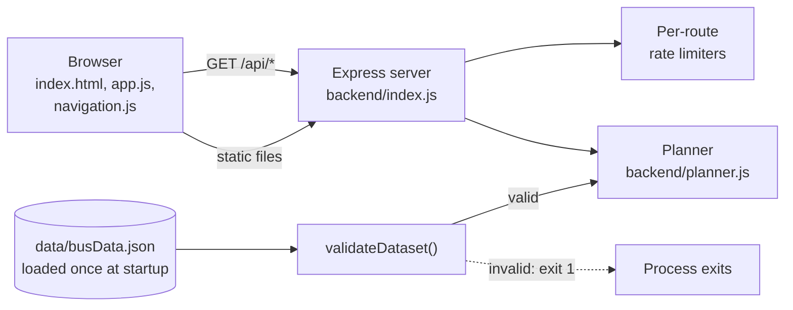

# Kudla Route

A Mangaluru city-bus finder. Enter two stops and it shows which bus to take and where to change, using route data stored in a single JSON file.

It is an Express 5 server, one dataset held in memory, and a plain HTML/CSS/JavaScript frontend. There is no database, no build step and no external service.

> **Status: v2.0.0, works locally, not release-ready on its own evidence.**
> The full test suite passes (117 tests, reproduced) and `npm audit` reports no vulnerabilities. But the app has never been deployed, no CI run exists, there are no browser tests, and the route data is only partly checked. Read [Status and limitations](docs/status-and-limitations.md) before relying on any result.

## What it does

- Finds **direct** routes, routes with **one change** and routes with **two changes**, returns at most **five** journeys, and ranks them by fewer changes, then fewer stops. This is a heuristic, not travel time.
- Follows each route **in its stored direction only**. It never assumes a bus runs backwards.
- Forgives typing: casing, spacing, aliases (`IXE`, `lal bagh`) and small typos (`kankandy`). Ambiguous input gets suggestions instead of a guess.
- Lets you browse all 99 routes, open a stop to see which buses serve it, and share a search as a URL (`/?from=State Bank&to=Kunjathbail`).
- Labels every leg with what is and is not verified about it (endpoints, stop order, direction, current operation).

## What it does not do

- **No map.** None of the 186 stops has coordinates, and none are guessed.
- **No timetables, fares, travel times or live locations.**
- **No return directions.** Only the direction stored for each route is used.
- **No journeys needing three or more changes.**
- **No accounts and no server-side storage.** Recent searches live in the browser's `localStorage`.

## Know this before you rely on it

These are measured facts about the current dataset, not opinions. Method and detail are in [Planner](docs/planner.md#coverage-measured) and [Data](docs/data.md).

- **99 routes, 186 stops, 36 aliases.** 84 of the 99 routes start at _State Bank_.
- **Only 30.7% of ordered stop pairs (10,562 of 34,410) return any journey.** Because routes are stored one way, most "return" trips have no result. No stop can reach _State Bank_ at all, and 36 stops can never be a starting point.
- **Data quality is thin.** For 74 routes the two end stops matched a published source; for 25 they did not. Stop order, direction and current operation are unconfirmed for all 99.
- When there is no result, the app says "no connection **recorded**", which does not mean no bus runs.

## Quick start

Requires Node.js 22 or newer.

```bash
npm install
npm start          # http://localhost:3000
```

| Command                          | Purpose                                                                                                 |
| -------------------------------- | ------------------------------------------------------------------------------------------------------- |
| `npm start`                      | Run the server (`PORT`, default 3000)                                                                   |
| `npm run dev`                    | Run with `node --watch`                                                                                 |
| `npm test`                       | Run all 117 tests (about 10 s)                                                                          |
| `npm run data:report`            | Provenance and gap report for the runtime dataset                                                       |
| `npm run data:validate-baseline` | Structural check of the direction-aware baseline dataset; rewrites `data/KUDLA_DATASET_VALIDATION.json` |
| `node scripts/smoke.js [url]`    | Smoke test against a running server (see [known issue](docs/status-and-limitations.md#known-issues))    |

Configuration is two environment variables. `.env` files are **not** loaded automatically.

| Variable      | Default | Meaning                                                                                                                                        |
| ------------- | ------- | ---------------------------------------------------------------------------------------------------------------------------------------------- |
| `PORT`        | `3000`  | Listen port                                                                                                                                    |
| `TRUST_PROXY` | `false` | `1` (one trusted proxy hop) or `loopback`. Anything else is ignored with a warning. Needed for correct per-client rate limiting behind a proxy |

## API

Six read-only GET endpoints, same-origin, JSON.

| Endpoint              | Purpose                                            |
| --------------------- | -------------------------------------------------- |
| `/api/plan?from=&to=` | Journeys between two stops                         |
| `/api/stops?q=`       | Autocomplete (empty `q` returns the busiest stops) |
| `/api/stop/:name`     | One stop and the buses serving it                  |
| `/api/buses`          | Every route                                        |
| `/api/bus/:number`    | One route                                          |
| `/api/health`         | Liveness, counts and data version                  |

Full contract with real examples: [API](docs/api.md).

## How it fits together



The server loads `data/busData.json` at startup, validates it, builds in-memory indexes and serves everything from there. A second file, `data/kudla-route-data.json`, is a richer _direction-aware baseline_ that the app does **not** load; see [Data](docs/data.md).

## Repository layout

```
backend/
  index.js            Express app: middleware, six endpoints, startup, shutdown
  planner.js          Search, stop resolution, journey planning
  rate-limiter.js     In-memory fixed-window limiter
  validate.js         Runtime dataset validator
frontend/
  index.html, app.js, navigation.js, style.css, fonts/
data/
  busData.json                  Runtime dataset (the only one the app loads)
  kudla-route-data.json         Direction-aware baseline (not loaded)
  kudla-route-data.schema.json  JSON Schema for the baseline (not used by any script)
  KUDLA_DATASET_VALIDATION.json Generated report for the baseline
  scripts/                      report.js, direction-aware-report.js, migrate-evidence.js
  templates/pattern-verification.md  Template for recording field verification
scripts/smoke.js      Smoke test for a running server
test/                 12 test files, node:test
docs/                 Documentation (below)
```

## Documentation

| Document                                                 | Read it for                                                            |
| -------------------------------------------------------- | ---------------------------------------------------------------------- |
| [Architecture](docs/architecture.md)                     | Components, startup, middleware, request lifecycle, design decisions   |
| [Planner](docs/planner.md)                               | Search, stop resolution, journey algorithm, ranking, measured coverage |
| [API](docs/api.md)                                       | Endpoint contract, error codes, limits, real example responses         |
| [Data](docs/data.md)                                     | Dataset formats, evidence model, provenance, how to update the data    |
| [Frontend](docs/frontend.md)                             | UI behaviour, request lifecycle, accessibility, what the UI claims     |
| [Operations](docs/operations.md)                         | Running, proxies, health, logging, rollback, troubleshooting           |
| [Security](docs/security.md)                             | Controls that exist, threat model, what the operator must provide      |
| [Testing](docs/testing.md)                               | What the 117 tests cover and do not, reproduced results, performance   |
| [Development](docs/development.md)                       | Local workflow, conventions, adding routes, stops and aliases          |
| [Status and limitations](docs/status-and-limitations.md) | Release verdict, known issues, open work                               |

## License

`package.json` declares **ISC**. No `LICENSE` file was present in the export this documentation was written from; add one if you intend to distribute the code.
