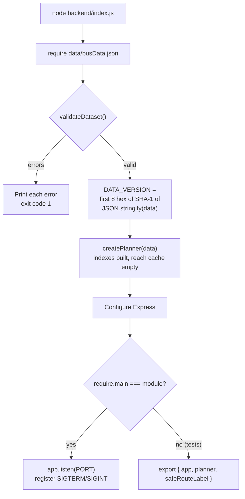
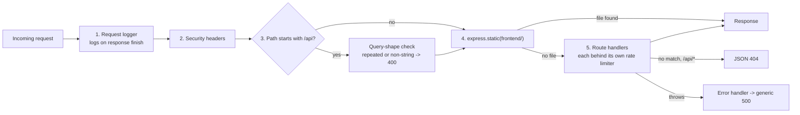
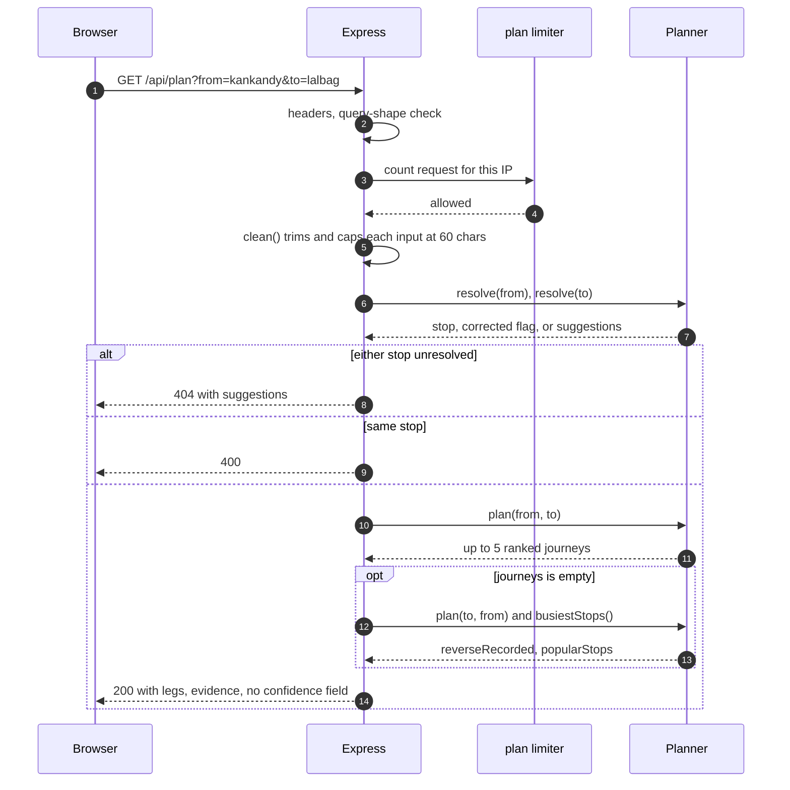

# Architecture

How the application is put together and why. Algorithm detail is in [Planner](planner.md); browser behaviour is in [Frontend](frontend.md).

## Principles the code follows

1. **Everything is in memory.** One JSON file is read at startup. There is no database, cache layer, queue or build step.
2. **Be honest about what is known.** Each route carries an `evidence` object that says which facts are confirmed. Direction is never invented: a route is traversed only the way it is stored.
3. **Fail at startup, not at request time.** An invalid dataset stops the process with a list of errors.
4. **No secrets, no state worth protecting.** The API is public and read-only. The server writes nothing to disk at runtime.

## Components

| File                                                          | Responsibility                                                                                                                                                                              |
| ------------------------------------------------------------- | ------------------------------------------------------------------------------------------------------------------------------------------------------------------------------------------- |
| `backend/index.js`                                            | Loads and validates data, builds the planner, configures Express (headers, query checks, logging, limiters, static files), defines the six endpoints, handles startup and graceful shutdown |
| `backend/planner.js`                                          | `createPlanner(data)`: indexes, fuzzy stop search, stop resolution, journey search and ranking                                                                                              |
| `backend/rate-limiter.js`                                     | `createRateLimiter()`: fixed-window, per-IP, per-limiter counters with periodic cleanup                                                                                                     |
| `backend/validate.js`                                         | `validateDataset(data)`: structural and semantic checks on `busData.json`; returns all errors rather than throwing                                                                          |
| `frontend/index.html`, `app.js`, `navigation.js`, `style.css` | Single-page UI. `navigation.js` is a small module that also loads in Node so tests can exercise it                                                                                          |
| `data/busData.json`                                           | The **runtime dataset**: the only data file the server reads                                                                                                                                |
| `data/kudla-route-data.json`                                  | A **direction-aware baseline** with richer structure. Not loaded by the app. See [Data](data.md)                                                                                            |
| `data/scripts/*`                                              | Reports and a one-off evidence migration. Not part of the server                                                                                                                            |
| `scripts/smoke.js`                                            | Smoke test for a running server                                                                                                                                                             |

## Startup

Measured on the committed dataset (Node 22, Linux container): requiring the module, validating and building the planner takes about 60 ms; resident memory is about 60 MB. Both are small enough not to need attention.

`DATA_VERSION` is a hash of the _re-serialised parsed_ JSON, not of the file bytes. It identifies the dataset content in `/api/health` but will not match `sha256sum data/busData.json`.

## Request pipeline

Middleware order matters and is fixed in `backend/index.js`:

Points that are easy to miss:

- **Static files are not rate limited.** Only the API handlers are.
- **Security headers apply to everything**, static and API alike, because they are set before the static middleware.
- **Unknown non-API paths** get Express's default HTML 404, not the JSON 404.
- **Rate limiters are per route group**, not global: `/api/plan` 30 per minute, `/api/stops` 120 per minute, and one shared limiter of 60 per minute for `/api/health`, `/api/buses`, `/api/bus/:number` and `/api/stop/:name`. See [Security](security.md#rate-limiting).
- **Request logs** print `METHOD route-template status duration`, for example `GET /api/stop/:name 200 3ms`. Query strings and dynamic path values are never logged; static files log as `METHOD /static`.

## Life of `GET /api/plan`

`confidence` exists in the dataset and in planner output but is **stripped before any API response**. The API exposes `evidence` only.

## State held by the process

| State                              | Lives in                | Lifetime               | Bound                                      |
| ---------------------------------- | ----------------------- | ---------------------- | ------------------------------------------ |
| Dataset                            | `require` cache         | Process                | Fixed (about 53 KB of JSON)                |
| Planner indexes                    | `createPlanner` closure | Process                | Fixed                                      |
| Reachability cache (`reach(stop)`) | `createPlanner` closure | Process, never evicted | At most one entry per stop (186)           |
| Rate-limit counters                | `rate-limiter.js` map   | Process                | Entries are removed after two idle windows |

Consequences: restarting resets rate limits; running several instances gives each its own counters; changing `busData.json` requires a restart.

Planning is synchronous CPU work on the single Node thread. A first-ever query that has to build reachability caches can take tens of milliseconds (up to about 38 ms observed); warm queries take well under a millisecond (see [Testing](testing.md#performance)).

## Decisions and trade-offs

**Forward-only traversal.** Each route is stored as one stop sequence. The original code let a bus run either way and so fabricated return journeys; it now walks only forward. The cost is large: most reverse trips return nothing. That is deliberate, and the UI says so rather than hiding it. See [Planner coverage](planner.md#coverage-measured).

**Two datasets.** `busData.json` is what runs. `kudla-route-data.json` restates the same 99 sequences, 186 stops and 36 aliases in a structure that can hold reverse patterns, per-claim sources and coordinates. All 99 sequences in the two files are identical (checked). The baseline adds structure, not new evidence. Moving the runtime to it needs a planner and validator rewrite; nothing does this yet.

**Evidence instead of confidence.** The old `high / medium / low` label described one thing only: whether the first and last stops matched a published list. The UI used to present it as general trust. It is now kept only as legacy metadata, and the API and UI describe four separate dimensions: endpoints, stop sequence, direction and current operation. See [Data](data.md#evidence-model).

**Plain frontend.** No framework or bundler. Text is inserted as DOM text nodes, which keeps the content-security policy strict (no inline scripts or styles).

**In-memory rate limiter.** Zero dependencies and adequate for one process. It does not coordinate across instances and relies on correct `TRUST_PROXY` configuration to see real client addresses.

**Explicit test list.** `npm test` names its 12 test files. A new test file does nothing until it is added to `package.json`.

## Sharp edges worth knowing

- `normalize()` keeps only `a-z` and `0-9`. A query in Kannada script normalises to an empty string and behaves like an empty query. This is fine for the current English-only dataset and would break for native-script stop names.
- Bus numbers must be stored in upper case: `getBus()` upper-cases the lookup key.
- A stop cannot appear twice in one route, so circular or loop routes cannot be represented in `busData.json`.
- Aliases are matched after normalisation, and `validateDataset` rejects two stops that normalise to the same name, because that would silently break transfers.

More issues, with evidence, are in [Status and limitations](status-and-limitations.md#known-issues).
