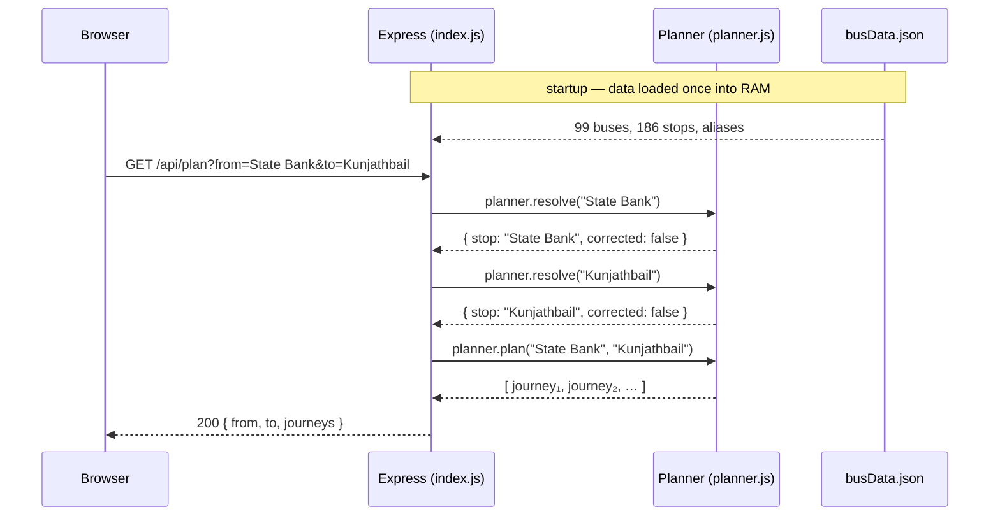
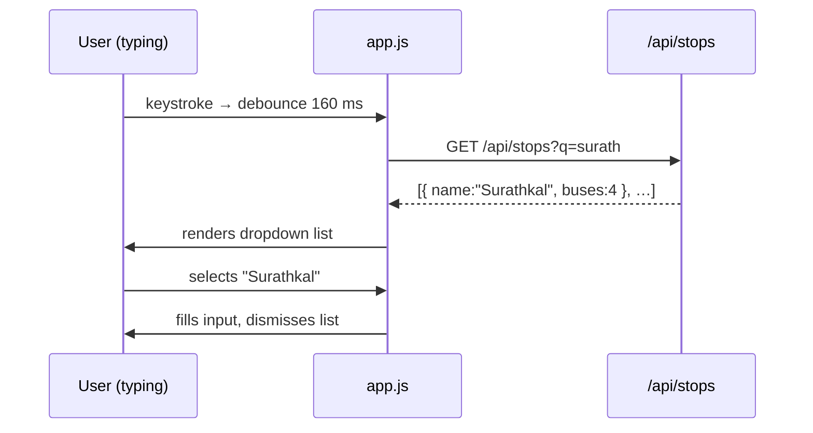

# Architecture

> **kudla-route** — Mangalore city-bus journey planner.
> One Express server, one JSON file in memory, zero runtime databases.

---

## High-level overview

```
Browser (index.html + app.js)
        │  HTTP  GET /api/plan?from=…&to=…
        │        GET /api/stops?q=…
        │        GET /api/buses
        │        GET /api/bus/:number
        ▼
  Node.js / Express  (backend/index.js)
        │  reads once at startup
        ▼
  In-memory data  ◄── data/busData.json
        │  passed into
        ▼
  Planner  (backend/planner.js)
        │  pure functions, no I/O
        ▼
  API response (JSON)  ──► Browser renders results
```

The server **never writes** to disk at runtime. All routes are read-only.

---

## Directory layout

```
kudla-route/
├── backend/
│   ├── index.js        Express server + API routes   (~75 lines)
│   └── planner.js      Route-finding logic            (~260 lines)
├── data/
│   └── busData.json    99 buses, 186 stops, aliases
├── frontend/
│   ├── index.html      Single-page UI
│   ├── style.css       Styles (self-contained)
│   ├── app.js          Client-side JS (fetch + DOM)
│   └── fonts/          Self-hosted Barlow woff2 files
├── test/
│   ├── api.test.js     HTTP integration tests (node:test)
│   ├── data.test.js    Data-integrity guards
│   └── planner.test.js Planner unit tests
├── docs/               ← You are here
├── package.json
├── DATA_NOTES.md
└── README.md
```

> [!NOTE]
> The `frontend/` folder is served as Express static files from the same origin as the API.
> No CORS configuration is needed.

---

## Request lifecycle



---

## Component responsibilities

| File                 | Owns                                               | Does NOT own   |
| -------------------- | -------------------------------------------------- | -------------- |
| `backend/index.js`   | HTTP routing, input validation, error responses    | Route logic    |
| `backend/planner.js` | Graph search, fuzzy matching, scoring              | HTTP, I/O      |
| `data/busData.json`  | Ground-truth stop lists, confidence flags, aliases | Business logic |
| `frontend/app.js`    | DOM rendering, autocomplete, URL state             | Server logic   |

---

## Data flow for autocomplete


