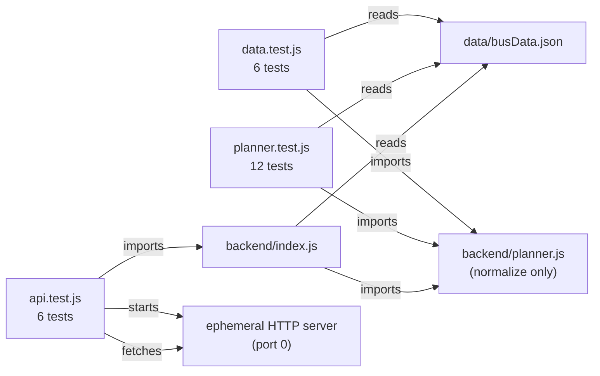

# Contributing & development guide

---

## Prerequisites

- **Node.js 20 or newer** (`node --version`)
- No global installs required

---

## Getting started

```sh
git clone <repo-url>
cd kudla-route
npm install         # installs Express (the only dependency)
npm start           # → http://localhost:3000
```

For auto-restart on file changes:

```sh
npm run dev         # node --watch backend/index.js
```

---

## Running tests

```sh
npm test            # all 24 tests: data integrity + planner unit + API integration
```

The test suite uses Node's built-in `node:test` runner — nothing extra to install.

### What is tested



| File              | Covers                                                                             |
| ----------------- | ---------------------------------------------------------------------------------- |
| `data.test.js`    | JSON schema, spelling, alias integrity                                             |
| `planner.test.js` | Direct/transfer routing, fuzzy matching, scoring, edge cases                       |
| `api.test.js`     | HTTP status codes, response shapes, typo correction over HTTP, static file serving |

---

## Project structure at a glance

| Path                  | Change here when you want to…                         |
| --------------------- | ----------------------------------------------------- |
| `data/busData.json`   | Add/fix a bus route or stop alias                     |
| `backend/planner.js`  | Change how routes are scored or how typos are matched |
| `backend/index.js`    | Add or change an API endpoint                         |
| `frontend/app.js`     | Change the UI behaviour                               |
| `frontend/style.css`  | Change the look                                       |
| `frontend/index.html` | Change page structure or metadata                     |
| `test/`               | Add or extend tests                                   |
| `docs/`               | Update documentation                                  |

---

## Adding a new bus route

1. Open `data/busData.json`.
2. Add an object to the `buses` array:

   ```json
   {
     "id": 100,
     "number": "99X",
     "confidence": "high",
     "stops": ["State Bank", "Car Street", "New Stop", "Surathkal"]
   }
   ```

3. Use an `id` one higher than the current maximum.
4. Use `"high"` only if you have personally verified the route ends against a reliable source.
5. Run `npm test` — the data tests will catch duplicate IDs, duplicate stop names, and stray whitespace.

---

## Adding a stop alias

If users commonly type a name differently from the canonical spelling in `stops`:

```json
"aliases": {
  "MCC": "Mangalore City Corporation",
  "city corporation": "Mangalore City Corporation"
}
```

Aliases are normalized (lowercase, punctuation stripped) before comparison, so
`"MCC"` and `"mcc"` both work automatically.

---

## Changing the routing penalty

`CHANGE_PENALTY` in `backend/planner.js` controls how much a bus change is penalised:

```js
const CHANGE_PENALTY = 6; // "changing bus costs about 6 extra stops"
```

Increase it to favour fewer-change journeys; decrease it to allow more creative alternatives.

---

## Environment variables

| Variable | Default | Description                    |
| -------- | ------- | ------------------------------ |
| `PORT`   | `3000`  | TCP port the server listens on |

```sh
PORT=8080 npm start
```

---

## Code style

- Plain CommonJS (`require` / `module.exports`) throughout — no transpiler, no bundler.
- No linter is configured. Keep functions small and name things clearly.
- All comments in existing files explain _why_, not _what_. Please maintain that standard.

---

## Making a production build

There is no build step. The server runs directly from source:

```sh
npm start
```

For a production deployment, set `NODE_ENV=production` and put a reverse proxy
(nginx, Caddy) in front to handle TLS and compression.
