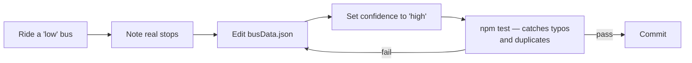

# Data format

`data/busData.json` is the single source of truth for all bus routes.
It is loaded once at startup and held in memory. No runtime writes.

---

## Top-level structure

```json
{
  "buses":   [ … ],
  "aliases": { … }
}
```

---

## Bus object

```json
{
  "id": 1,
  "number": "1",
  "confidence": "high",
  "stops": ["State Bank", "Car Street", "Hampankatta", "…", "Kunjathbail"]
}
```

| Field        | Type                              | Required | Notes                                                      |
| ------------ | --------------------------------- | -------- | ---------------------------------------------------------- |
| `id`         | integer                           | Yes      | Unique internal id. Never changes.                         |
| `number`     | string                            | Yes      | Route number, uppercase — `"17A"`, `"45B"`.                |
| `confidence` | `"high"` \| `"medium"` \| `"low"` | Yes      | See [DATA_NOTES.md](../DATA_NOTES.md)                      |
| `stops`      | string[]                          | Yes      | Ordered stop list. First = origin, last = terminus. Min 2. |
| `note`       | string                            | No       | Optional free-text note shown to the user.                 |

> [!IMPORTANT]
> `stops[0]` and `stops[stops.length - 1]` are the canonical route ends.
> There is no separate `from` / `to` field (they were removed in the cleanup — see DATA_NOTES §3).

---

## Aliases

```json
{
  "aliases": {
    "airport": "Bajpe Airport",
    "IXE": "Bajpe Airport",
    "Mangalore Airport": "Bajpe Airport",
    "lalbagh": "Lalbagh",
    "statebank": "State Bank"
  }
}
```

An alias maps **any spelling a user might type** to the canonical stop name that appears
in `stops` arrays. Aliases survive even when you merge duplicate stop names.

> [!TIP]
> To add a new alias, append to the `aliases` object and run `npm test` —
> `data.test.js` will catch any alias that points at a non-existent stop.

---

## Confidence levels

| Level      | Meaning                                                       | Count |
| ---------- | ------------------------------------------------------------- | ----- |
| `"high"`   | Both Wikipedia and the local bus list agree on the route ends | 49    |
| `"medium"` | One source agrees                                             | 25    |
| `"low"`    | Neither source lists this number, or the two sources disagree | 25    |

Low-confidence buses to check first:
`1C 2D 2F 3 3B 10B 12A 13E 14B 22A 30A 30B 31A 41A 43 45A 45B 45E 45F 47B 48 48A 53 53A 54A`

---

## Validation rules (enforced by `npm test`)

| Rule                                                  | Test file      |
| ----------------------------------------------------- | -------------- |
| All `id` values are unique                            | `data.test.js` |
| All `number` values are unique                        | `data.test.js` |
| Every route has ≥ 2 stops                             | `data.test.js` |
| No stop appears twice in one route                    | `data.test.js` |
| No trailing whitespace or punctuation in stop names   | `data.test.js` |
| No two stops are the same name normalized differently | `data.test.js` |
| Every `confidence` is `high`, `medium`, or `low`      | `data.test.js` |
| Every alias points at a stop that exists in `stops`   | `data.test.js` |

---

## How to improve the data



1. Pick a bus from the low-confidence list above.
2. Ride it and note the actual stops in order.
3. Edit `data/busData.json`.
4. Set `"confidence": "high"`.
5. Run `npm test` from the project root.
6. Fix any failures (usually a spelling that now duplicates an existing stop — add an alias instead of a new name).
7. Commit.

If two stops you thought were different turn out to be the same place, merge them and add the old name as an alias. Transfers at that stop will then start working automatically.
