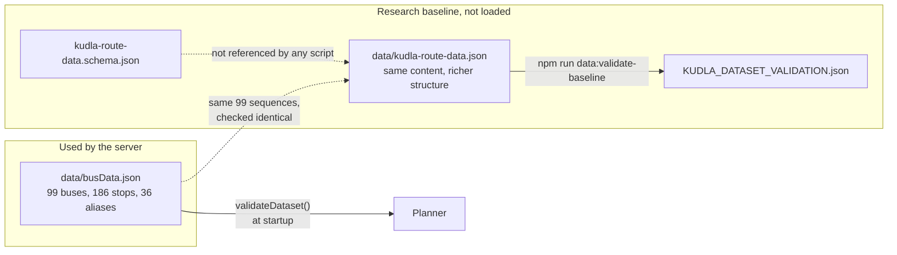

# Data

What is in the dataset, how far it can be trusted, how the two data files relate, and how to change them safely. The numbers in this document were computed from the committed files on 2026-11-13.

## Two datasets



|            | `busData.json`                                | `kudla-route-data.json`                                                    |
| ---------- | --------------------------------------------- | -------------------------------------------------------------------------- |
| Role       | **Runtime.** Read by the server               | Research and migration baseline. **Not loaded**                            |
| Shape      | `{ updated, buses[], aliases{} }`             | `{ metadata, sources, agencies, stops, routes, aliases, service_notices }` |
| Stops      | Plain names inside each bus                   | Records with IDs, `location`, `identity_status`, `served_by_route_ids`     |
| Directions | One stop list per bus                         | One `listed_sequence` pattern per route, reverse explicitly "unverified"   |
| Provenance | Per-bus `evidence` and legacy `confidence`    | Source register, per-route cross-checks, per-pattern status                |
| Validator  | `backend/validate.js` at startup and in tests | `data/scripts/direction-aware-report.js` (hand-written checks)             |
| Size       | 52,996 bytes                                  | 280,134 bytes                                                              |

The baseline restates the runtime data and adds nothing factual. For all 99 routes the stop sequence is identical in both files, the 36 aliases match, the stop sets match and the 9 route notes are carried over. **Switching the server to the baseline needs a planner and validator rewrite** (the old file must not be overwritten until that exists and its tests pass).

## The runtime dataset: `data/busData.json`

### Shape

```json
{
  "updated": "2026-11-11",
  "buses": [
    {
      "id": 1,
      "number": "1",
      "confidence": "high",
      "evidence": {
        "endpoints": "PARTIALLY_VERIFIED",
        "stopSequence": "UNKNOWN",
        "direction": "UNKNOWN",
        "currentOperation": "UNKNOWN"
      },
      "stops": [
        "State Bank",
        "Car Street",
        "Mannagudda",
        "Ladyhill",
        "Chilimbi",
        "Urva Stores",
        "Kavoor",
        "MCF Colony",
        "Kunjathbail"
      ]
    }
  ],
  "aliases": { "Lal Bagh": "Lalbagh", "IXE": "Bajpe Airport" }
}
```

| Field                | Meaning                                                                                                                  |
| -------------------- | ------------------------------------------------------------------------------------------------------------------------ |
| `updated`            | Real calendar date, `YYYY-MM-DD`                                                                                         |
| `buses[].id`         | Positive integer, unique. Currently 1 to 99, contiguous                                                                  |
| `buses[].number`     | The route number shown on the bus (`"45A"`). Unique ignoring case and whitespace. **Store it in upper case** (see below) |
| `buses[].stops`      | Ordered stop names in the **one stored direction**. First is the origin, last the terminus                               |
| `buses[].confidence` | Legacy label `high`, `medium` or `low`; see [Evidence model](#evidence-model). Never sent by the API                     |
| `buses[].evidence`   | Four independent statuses; sent by the API                                                                               |
| `buses[].note`       | Optional free text, sent by the API. 9 buses have one                                                                    |
| `aliases`            | Alternative spelling to canonical stop name. Matched after normalisation, so case, spacing and punctuation do not matter |

### What `validateDataset()` enforces

On any error the server prints every problem and exits with code 1. Messages below are real.

| Rule                                                                                                        | Example message                                                                                       |
| ----------------------------------------------------------------------------------------------------------- | ----------------------------------------------------------------------------------------------------- |
| `updated` is a real `YYYY-MM-DD` date                                                                       | `data.updated must be a valid "YYYY-MM-DD" date`                                                      |
| `id` is a positive integer and unique                                                                       |                                                                                                       |
| `number` is non-empty, has no surrounding spaces, and is unique after trim and upper-casing                 | `buses[1] (1): number "1" duplicates buses[0] after normalization`                                    |
| At least 2 stops, each a non-empty trimmed string                                                           |                                                                                                       |
| No stop repeated within one bus                                                                             | `buses[0] (1): stop "State Bank" appears more than once`                                              |
| Two different stop names must not normalise to the same text                                                | `stop names "Car Street" and "car  street" collide after normalization`                               |
| `confidence` is `high`, `medium` or `low`                                                                   |                                                                                                       |
| `evidence` has four dimensions, each a valid status                                                         |                                                                                                       |
| `VERIFIED` is not allowed                                                                                   | `evidence.endpoints claims VERIFIED but the legacy runtime dataset has no per-claim source reference` |
| `high` or `medium` confidence cannot have `UNVERIFIED` or `UNKNOWN` endpoints                               | `legacy high endpoint confidence conflicts with evidence.endpoints="UNKNOWN"`                         |
| Aliases point to real stops, and normalised aliases do not collide with a different stop or with each other | `alias "mcc" points to unknown stop "Mangalore City Corporation"`                                     |

### What it does not enforce

- **Upper-case bus numbers.** A unique number such as `"99x"` passes validation and appears in `/api/buses` and in journeys, but `getBus()` looks up the _upper-cased_ input against raw keys, so neither `/api/bus/99x` nor `/api/bus/99X` can ever find it (checked). Always store numbers in upper case.
- **That a route is real, current or correct.** Validation is structural. Nothing here checks facts.
- **Loops.** A stop cannot appear twice in a bus, so circular routes cannot be stored.
- **Coordinates, times or operators.** The format has no place for them.

### Dataset facts

|                                       |                                                                                                   |
| ------------------------------------- | ------------------------------------------------------------------------------------------------- |
| Routes (buses)                        | 99                                                                                                |
| Distinct stops                        | 186 (1,103 stop slots across routes)                                                              |
| Aliases                               | 36                                                                                                |
| Stops per route                       | min 5, median 10, max 19                                                                          |
| Routes that start at _State Bank_     | **84** of 99 (7 start at _Mangaladevi_, 3 at _Kankanady_, the rest one each)                      |
| Busiest stops                         | _State Bank_ 84 routes, _Lalbagh_ 37, _Jyothi_ 36, _Kankanady_ 33, _Ladyhill_ 27, _Mallikatte_ 25 |
| Stops served by exactly one route     | 60 of 186                                                                                         |
| Most common terminus                  | _Bajpe_ (8 routes), _Bondel_ (5), _Kunjathbail_ and _Moodushedde_ (4 each)                        |
| Routes with identical full stop lists | 2E and 2F; 17, 17A and 17B; 30 and 37; 45A and 45B; 47 and 47A                                    |
| Stop-name characters                  | All plain ASCII                                                                                   |

The star shape around _State Bank_ explains most of the [planner's coverage numbers](planner.md#coverage-measured).

## Evidence model

Each bus records four separate claims, each with its own status:

| Dimension          | Question it answers                                                           |
| ------------------ | ----------------------------------------------------------------------------- |
| `endpoints`        | Are the first and last stops right for this route number?                     |
| `stopSequence`     | Is the full ordered list of intermediate stops right?                         |
| `direction`        | Does the bus really run in this direction, and is the return direction known? |
| `currentOperation` | Is the service running today?                                                 |

Statuses, strongest to weakest: `VERIFIED`, `PARTIALLY_VERIFIED`, `UNVERIFIED`, `CONFLICTING`, `HISTORICAL`, `UNKNOWN`.

**Current state of the data (all 99 buses):**

| Dimension          | Values                                   |
| ------------------ | ---------------------------------------- |
| `endpoints`        | `PARTIALLY_VERIFIED` 74, `UNVERIFIED` 25 |
| `stopSequence`     | `UNKNOWN` 99                             |
| `direction`        | `UNKNOWN` 99                             |
| `currentOperation` | `UNKNOWN` 99                             |

**Rules.**

1. Never promote one dimension by inference from another. Matching end stops says nothing about intermediate stops; a route number appearing in a directory says nothing about whether it runs.
2. `PARTIALLY_VERIFIED` covers only the part of a claim the recorded evidence supports. `VERIFIED` requires current, authoritative evidence for the _whole_ claim.
3. Keep source, date, method, direction and scope with any evidence you record.

What evidence each promotion needs:

| Claim             | Evidence needed                                                                                                                                                 |
| ----------------- | --------------------------------------------------------------------------------------------------------------------------------------------------------------- |
| Endpoints         | A dated source or field record that identifies the route and both ends in the same direction                                                                    |
| Stop sequence     | Evidence covering the ordered stops claimed. A directory that lists only the route number is not enough; partial observation does not verify the whole sequence |
| Direction         | Evidence of the specific origin-to-destination direction. A stored direction does not establish a return pattern; verify the return separately                  |
| Current operation | Dated operator or current-service evidence, or a dated observation. A listing or an old ride does not establish continuing operation                            |

### The legacy `confidence` label

`high`, `medium` and `low` came from comparing the dataset with two public pages: a Wikipedia list of Mangaluru city bus routes and a local blog list. For each of the 99 routes, a match meant _same route number and same start and end stop_:

| Label    | Meaning                                                          | Routes |
| -------- | ---------------------------------------------------------------- | -----: |
| `high`   | Both sources agree on the endpoints                              |     49 |
| `medium` | One source agrees                                                |     25 |
| `low`    | Neither source lists those endpoints, or the route is not listed |     25 |

This is endpoint comparison only. It says nothing about stop order, direction or whether the bus runs. The server maps it into `evidence.endpoints` (`high` and `medium` become `PARTIALLY_VERIFIED`, `low` becomes `UNVERIFIED`), and a test keeps the two in step. The label is retained for tests and the provenance report and is stripped from API responses.

The "agreed with N sources" wording once used in reports is not backed by a source register in the repository, so do not quote source counts.

The low-confidence routes to verify first: `1C 2D 2F 3 3B 10B 12A 13E 14B 22A 30A 30B 31A 41A 43 45A 45B 45E 45F 47B 48 48A 53 53A 54A`.

## Provenance and history

- **Sources used for the legacy comparison:** [Wikipedia, "Mangaluru City Bus routes"](https://en.wikipedia.org/wiki/Mangaluru_City_Bus_routes) and a local-bus list at `mangaloreindia.blogspot.com/p/local-bus-transport.html`.
- **Spot check.** For 8 routes (1, 10A, 12A, 15, 17, 27, 45, 51) the intermediate stops were compared with the local list, and **they differed in every case**. This is why `stopSequence` is `UNKNOWN` for every route.
- **Numbering.** The dataset uses an older route-numbering scheme. Wikipedia shows both the older and newer numbers, so a match on number does not always mean the same route.
- **Clean-up already done:** stop names merged by spelling from 209 down to the current 186; `from`/`to` fields that contradicted the stop list were removed on 9 buses (10A, 11A, 13A, 13D, 22A, 33, 3C, 47B, 9B); 97 entries with stray spaces or punctuation fixed; _Bajpe Aerodrome_ renamed _Bajpe Airport_; bus numbers made plain strings.
- **Judgement calls.** Stops that look related were left separate (see [Stop identity](#stop-identity-decisions)).
- **Baseline cross-checks (separate record).** The baseline records that 75 of 99 route numbers appear in one public directory (`mangalore.city`). That is _route-number presence only_ and is a different test from the legacy endpoint comparison: 18 of the 25 `low` routes are listed there, and 9 `high` routes are not. The baseline also lists two further directories as sources but records no per-route checks against them.

## The baseline dataset: `data/kudla-route-data.json`

Not used by the server. Useful because it has places to put the things the runtime format cannot hold.

| Section                    | Content in the current file                                                                                                                                                                                                                                                        |
| -------------------------- | ---------------------------------------------------------------------------------------------------------------------------------------------------------------------------------------------------------------------------------------------------------------------------------- |
| `metadata`                 | Dataset ID, schema version `2.0.0`, dates (2026-11-12), `official_status: "not_officially_verified"`, five important constraints, record counts                                                                                                                                    |
| `sources`                  | 5: the legacy dataset, three public route directories, and a dated KSRTC notice                                                                                                                                                                                                    |
| `agencies`                 | Empty                                                                                                                                                                                                                                                                              |
| `stops`                    | 186. `stop_id` like `stop-state-bank`, `location: null` for **all**, `identity_status: "name_only_not_geospatially_verified"` for all                                                                                                                                              |
| `routes`                   | 99. `route_id` like `route-1`, `operating_status: "unknown"` for all, `reverse_service_status: "unknown"` for all, legacy metadata, `external_cross_checks`, `notes`                                                                                                               |
| `patterns` (inside routes) | 99, one per route: `direction_type: "listed_sequence"`, `directionality_status: "one_direction_recorded_reverse_unverified"`, `verification_status: "unverified"`, `last_verified_at: null`                                                                                        |
| `aliases`                  | 36, alias to stop ID                                                                                                                                                                                                                                                               |
| `service_notices`          | 1: a KSRTC notice dated 2026-06-13 for services from Mangaluru Junction Railway Station (to Kateel, Bokkapatna, State Bank and Kodikal) with departure times. Marked `historical_notice_current_status_unknown` and `planner_eligible: false`; deliberately not merged into routes |

The JSON Schema (`kudla-route-data.schema.json`) is loose: most statuses are plain strings rather than enumerations, `additionalProperties: false` applies only at the top level, and its `$id` is a placeholder (`example.invalid`). **No script reads it**; `direction-aware-report.js` does its own checks. Treat it as documentation of intent.

## Stop identity decisions

A wrong **merge** silently creates transfers that cannot happen. A wrong **split** silently removes transfers that could. Default decision for every group: **keep separate** until a rider, driver or field visit says otherwise; then add an alias in `busData.json` and run `npm test`.

All bus lists below were re-checked against the data on 2026-11-13.

| Group     | Stops (routes serving each)                                                                                                  | Decision                                                                                              | What would change it                                           |
| --------- | ---------------------------------------------------------------------------------------------------------------------------- | ----------------------------------------------------------------------------------------------------- | -------------------------------------------------------------- |
| Kadri     | Kadri (22), Kadri Market (3: 15, 15A, 15B), Kadri Temple (2: 60, 61); no overlap                                             | Separate                                                                                              | Field confirmation that two names are one boarding point       |
| Bejai     | Bejai (5), Bejai Church (1: 48A, which also serves Bejai), Bejai Museum (2: 60, 61)                                          | Separate                                                                                              | Confirmation that Bejai Church is Bejai; museum looks distinct |
| Kottara   | Kottara (1: 13A), Kottara Cross (8), Kottara Chowki (10); 19 distinct routes, no overlap                                     | Separate                                                                                              | Field confirmation                                             |
| Padangady | Padangady (13D, 14A, 14B, 14C), Padavinangadi (19). On 13D, Padangady comes right after Bondel; on 14A it comes right before | Separate                                                                                              | Field confirmation of whether these are one place              |
| Kulshekar | Kulshekar (14), Kulshekar Chowki (1: bus 4, which lists both)                                                                | Separate. **Blocked by data**: merging would put one stop twice in bus 4, which the validator forbids | Resolve bus 4's stop list first                                |
| Urva      | Urva Stores (16), Urva Market (31, 31A, 31B)                                                                                 | Separate                                                                                              | Field confirmation                                             |
| Bajpe     | Bajpe (11), Bajpe Airport (22A, 47B, 47C, all of which also serve Bajpe)                                                     | **Confirmed separate**: those buses list both in order                                                | None needed                                                    |

## Tools

| Command                                 | What it does                                                                                                                                                                                                                                                  | Safe to run?         |
| --------------------------------------- | ------------------------------------------------------------------------------------------------------------------------------------------------------------------------------------------------------------------------------------------------------------- | -------------------- |
| `npm run data:report`                   | Analyses `busData.json`: SHA-256, confidence distribution, evidence table, and for each route how many extra stop pairs a verified return pattern would unlock (up to 926 `terminal to stop` pairs). Finishes in under a second                               | Read-only            |
| `npm run data:validate-baseline`        | Checks `kudla-route-data.json` structure and counts, prints a summary, and **rewrites** `KUDLA_DATASET_VALIDATION.json` (atomically; exits 1 if invalid)                                                                                                      | Writes one file      |
| `node data/scripts/migrate-evidence.js` | One-off helper that adds default `evidence` objects to a legacy file that lacks them. Dry run by default; `--write` makes a timestamped backup and replaces the file atomically; `--input` picks another file. Idempotent, never downgrades existing evidence | Dry run is read-only |

Notes:

- `npm run data:report` has no `require.main` guard: importing the script runs it. Its on-screen "this may take ~30s" is stale (it takes under a second), and its header text about "N sources" contradicts the rule above. Neither affects the result.
- The committed validation report is current: regenerating it produced a byte-identical file (280,134 bytes, SHA-256 `1abd39377df7dc6239de298152a9d7919686f0eb26373efd45a86ba190bf40c0`).
- `direction-aware-report.js` counts routes with a verified reverse pattern by reading `pattern.route_id`, which patterns do not have. With zero reverse patterns today the result is correct (0); once any exist, the count would be wrong.
- The migration is already applied to the committed data (every bus has `evidence`), so it is mostly historical. Its backups (`busData.json.bak.<timestamp>.<pid>`) are not git-ignored.

## Updating the data

Do this for any change to `data/busData.json`.

1. **Have evidence.** Record where the change comes from (see `data/templates/pattern-verification.md`, which is the form for recording a field check or published-source comparison). Do not add a stop you have not directly confirmed, and do not infer stops from a map.
2. **Back up.** `cp data/busData.json data/busData.json.bak-$(date +%Y%m%d-%H%M%S)` (or just rely on git).
3. **Edit.** For a new route use the next free `id`, an **upper-case** `number`, an ordered `stops` list, a `confidence`, and an `evidence` object. Reuse existing stop spellings exactly. For a new alias, point it at an existing canonical stop.
4. **Check syntax and structure.** `node -e "require('./data/busData.json')"`, then `npm test`. The validator names every problem, as in the table above.
5. **Do not claim more than you know.** `VERIFIED` is rejected in this file. Keep confidence and evidence consistent: `high`/`medium` need `PARTIALLY_VERIFIED` endpoints, `low` needs `UNVERIFIED`.
6. **Bump `updated`** to today's date.
7. **Restart the server.** Data is read once at startup. Confirm `/api/health` shows the expected counts and a new `dataVersion`.
8. **Roll back** by restoring the file (or `git revert`) and restarting. Never replace stronger evidence with weaker. See [Operations](operations.md#rollback).

A change that adds or removes a stop or route can change the exhaustive-test counts and the coverage figures in these docs. Re-run `npm run data:report` and the [reproduce snippet](planner.md#reproduce) and update the numbers.

## Coordinates and maps

None of the 186 stops has coordinates, and none are guessed. A map was considered and deliberately not built: guessed geocoding was rejected, and a map restricted to verified coordinates was deferred because there are none. To unlock it, a contributor would need to collect each stop's position in the field or from a reliable geospatial source, recording the stop name, latitude and longitude, source, access date, accuracy and reviewer; a tile provider and its usage terms would then need review.

## Required before the data is fit for passenger guidance

All of this is human work that code cannot do:

1. Verify each route number and its current operation with an operator or by field observation.
2. Capture each direction separately, with the real stop order and terminal.
3. Decide, on the ground, whether similarly named stops are the same boarding point.
4. Record evidence per claim: source, observation date, method, direction and the exact segment verified.
5. Promote only the dimension and scope the evidence supports.
6. Treat every return direction as its own pattern with its own evidence. This is the single biggest improvement available: `npm run data:report` estimates up to 926 additional `terminal to stop` pairs.
7. Add stop coordinates only from a reliable source, with accuracy and provenance.
