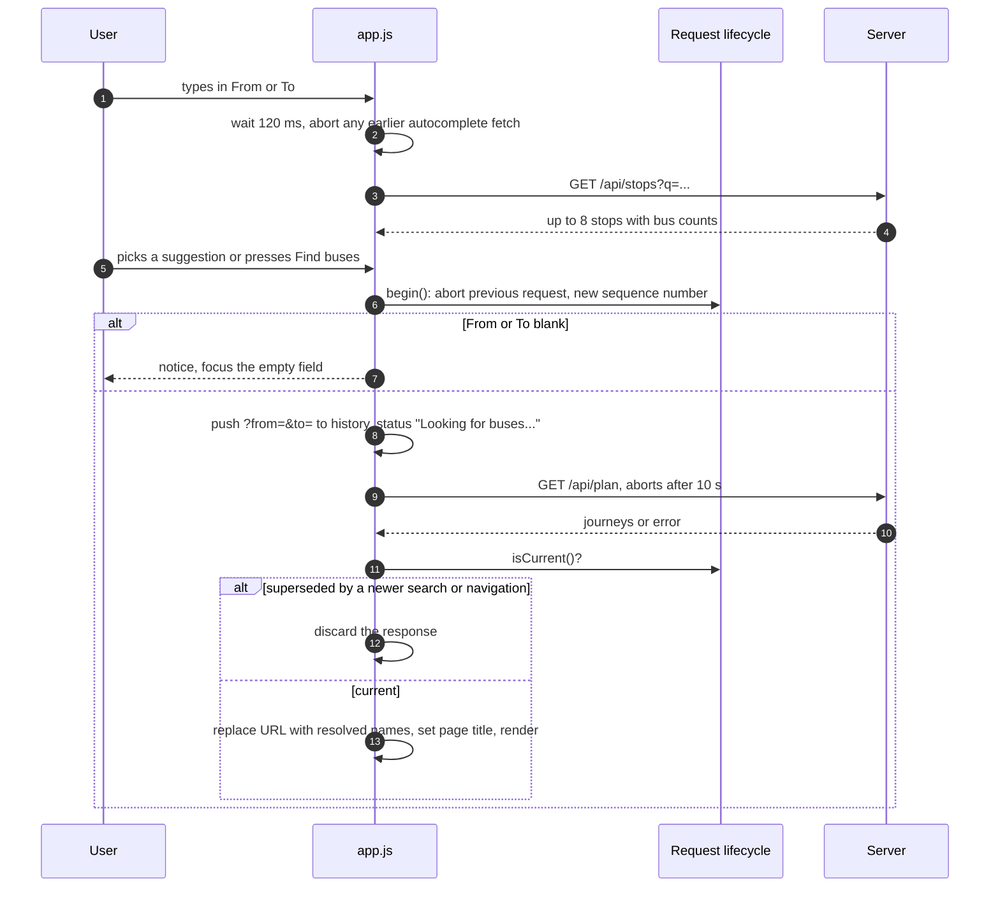

# Frontend

A single page served as static files from `frontend/`. No framework, bundler or runtime dependency. This document describes behaviour read from `index.html`, `app.js` and `navigation.js`.

> **Not covered here:** `style.css` and the font files were not available for this review, so visual design, layout and the project's stated touch-target and contrast work are undocumented. There are also no browser tests (see [Testing](testing.md#what-is-not-tested)), so everything below comes from reading the code, not from watching it run in a browser.

## Files

| File                  | Role                                                                                                                                                                         |
| --------------------- | ---------------------------------------------------------------------------------------------------------------------------------------------------------------------------- |
| `index.html`          | Page skeleton: planner form, status line, results, "Browse all bus routes", data disclaimer footer, `<noscript>` notice                                                      |
| `navigation.js`       | `createRequestLifecycle()` and `handlePopState()`. Loaded first. Works in the browser (`window.KudlaNavigation`) and in Node (`module.exports`), which is how tests reach it |
| `app.js`              | Everything else, in one function scope                                                                                                                                       |
| `style.css`, `fonts/` | Styling and five self-hosted Barlow font files                                                                                                                               |

`index.html` loads `navigation.js` before `app.js` (a test checks the order), uses no inline scripts or styles, and references `favicon.svg`, which was not in the reviewed file tree (see [Status](status-and-limitations.md#known-issues)).

## What happens when someone searches

### The request lifecycle

`createRequestLifecycle(goButton)` guards against stale responses. Each `begin()` aborts the previous request, increments a sequence number and clears the button's `aria-busy`. A response is rendered only if its sequence number is still current. `invalidate()` does the same for history navigation. `markBusy()` and `clearBusy()` set and clear `aria-busy` on the button, and only for the current request.

A search aborts after **10 seconds** (`AbortSignal.timeout`, combined with the lifecycle's own signal where `AbortSignal.any` exists). Stop-detail lookups abort after 5 seconds.

### URL and history

- A new search adds a history entry (`pushState`) with `?from=…&to=…`, unless the URL already matches.
- When the server answers, the URL is rewritten (`replaceState`) to the **resolved** stop names, so a shared link contains canonical names, and `document.title` becomes `"<from> to <to> | Kudla Route — Mangaluru Bus Finder"`.
- Back and forward (`popstate`) restore the form and re-run the search, or clear the results if the entry has no search.
- Opening a link such as `/?from=State%20Bank&to=Kunjathbail` fills the form and runs the search on load.
- The **swap** button exchanges the two fields and searches if both are filled.

## Features

| Feature           | Behaviour                                                                                                                                                                                                                                                                                                                        |
| ----------------- | -------------------------------------------------------------------------------------------------------------------------------------------------------------------------------------------------------------------------------------------------------------------------------------------------------------------------------- |
| Autocomplete      | Debounced 120 ms; fetches on input, on focus and on ArrowDown; each new fetch aborts the previous one. Keyboard: Up and Down wrap, Enter picks the highlighted item **only if** it was fetched for the text now in the box, Escape closes. Picking one field runs the search if the other is filled, otherwise moves focus to it |
| Results           | "Best way" (first journey) then "Other ways". Each journey has a heading with bus plates, a summary such as `Direct, 8 stops` or `1 change, 6 stops`, the ranking note, and an ordered trip. A leg shows `Take` or `Take any of`, up to 4 bus plates with `+N more`, `for N stops`, and a collapsible list of intermediate stops |
| Stop details      | Each stop name in a journey is a button. It fetches `/api/stop/:name` and appends a panel at the **end** of the results (so it can be far below the stop clicked) showing aliases, the buses serving the stop and the server's note. Clicking again toggles it; Close removes it                                                 |
| Share             | "Share / Copy link" next to "Best way". Uses the Web Share API where present, otherwise copies `location.href`. It shares the page URL, not a written itinerary                                                                                                                                                                  |
| Recent searches   | Up to 5, saved in `localStorage` under `kudla_recent_searches`, only after a search that returned journeys. Shown as chips with "Clear" and the notice "Searches are saved locally on this device only." Storage errors are swallowed                                                                                            |
| Browse all routes | A `
` section that loads `/api/buses` once, on first open. The filter ranks: exact bus number, then number prefix, then any match in the number or stop names. Each row expands to the full stop list                                                                                                                    |
| Corrections       | If the server corrected an input, the status line says `Showing results for: "typed" → "fixed".` (only when the text actually differs ignoring case)                                                                                                                                                                             |
| Line colours      | Eight colours chosen by `bus number mod 8`. Purely decorative: the bus number, not the colour, identifies a bus                                                                                                                                                                                                                  |

## What the page tells the user

All strings are in `app.js` or `index.html`.

| Situation                               | Text                                                                                                                                                                     |
| --------------------------------------- | ------------------------------------------------------------------------------------------------------------------------------------------------------------------------ |
| Blank field                             | Enter a starting stop and a destination.                                                                                                                                 |
| Searching                               | Looking for buses…                                                                                                                                                       |
| Unknown stop                            | The server's message (`No stop found for "x".`) plus "Did you mean:" chips                                                                                               |
| No journey, opposite direction recorded | `No recorded route from A to B within 2 changes. A route from B to A is recorded in that direction — return directions are unverified, which does not mean no bus runs.` |
| No journey, nothing recorded            | `No connection recorded between A and B within 2 changes. Busiest stops (most buses): x, y, z.`                                                                          |
| Timeout                                 | The request took too long. Check your connection and try again.                                                                                                          |
| Server unreachable                      | Can't reach the server. Check your connection and try again.                                                                                                             |
| Share                                   | Link copied to clipboard. / Could not copy link. Copy the address bar manually.                                                                                          |
| Route list                              | Loading bus routes… / Couldn't load the routes. Check your connection and reopen this section. / No bus matches that. Try a stop name or a number.                       |
| Stop panel                              | Loading details for X… / Stop "X" not found. / Could not load stop details. / No recorded buses serve this stop.                                                         |
| JavaScript off                          | Kudla Route requires JavaScript to work. Please enable JavaScript in your browser to find bus routes.                                                                    |

The footer states: endpoints were cross-checked against public sources for most routes; intermediate stop sequences have **not** been independently confirmed for any route; return directions are unverified and only the stored forward direction is used; operators change routes and numbers, so check the destination board with the conductor; the site is not an official operator service and has no timetables, fares or live locations.

### Evidence text is hard-coded

Each leg and each browsed bus shows a line built from `evidence.endpoints` only:

| `endpoints`          | Journey leg                                 | Route list                                                                     |
| -------------------- | ------------------------------------------- | ------------------------------------------------------------------------------ |
| `PARTIALLY_VERIFIED` | Endpoints matched in a published source.    | Endpoints matched in a published source. Stop order and direction unconfirmed. |
| `VERIFIED`           | Endpoints independently verified.           | Endpoints independently verified. Stop order and direction unconfirmed.        |
| anything else        | Endpoints not confirmed against any source. | Not confirmed against any source. Check with conductor before boarding.        |

A journey leg then **always** adds "Stop order, direction, and current service: not independently confirmed." whatever the other three evidence dimensions say. That is accurate for today's data (all `UNKNOWN`), but the page does not read those dimensions. If stop sequences or operation get verified in the data, the UI will keep saying they are not until `evidenceText()` is changed.

## Security-relevant behaviour

- All dynamic content is inserted through a small helper that creates DOM nodes and sets text. A search of `frontend/` finds no `innerHTML`, `outerHTML`, `insertAdjacentHTML`, `document.write` or `eval`.
- Colours are applied with `style.setProperty`, never `setAttribute("style", …)`, because the content-security policy (`style-src 'self'`) blocks inline style attributes.
- The page makes same-origin requests only.
- `localStorage` holds only the recent-search list.

## Accessibility (as written in the markup and script)

- A "Skip to journey planner" link, a visible label on each input, and `autocomplete="off"` on the form.
- The two stop inputs are ARIA comboboxes: `role="combobox"`, `aria-expanded`, `aria-controls`, `aria-autocomplete="list"`, with `role="listbox"` lists whose items are `role="option"` with `aria-selected` and `aria-activedescendant`; the active option scrolls into view.
- The status line is `role="status"` with `aria-live="polite"`; error and info notices are `role="alert"`.
- The search button gets `aria-busy` while a search runs. Stop names are real buttons with an `aria-label`. Intermediate stops and the route list use `
` and `
`.
- `<html lang="en-IN">`.

None of this has been tested with a screen reader, a keyboard-only session or an automated checker such as axe-core. The code is what a careful implementation looks like; it is not evidence that the page passes.

## Known gaps

- No browser or accessibility testing exists; the navigation tests run the lifecycle module in Node, and one test checks `app.js` by matching its source text.
- Hard-coded evidence text (above).
- The stop-detail panel appears at the bottom of the results.
- A stale comment at the end of `app.js` says the stop-detail function is "not auto-triggered"; it is, through the stop-name buttons.
- Stop matching is ASCII-only, so a query typed in Kannada script is treated as an empty query (see [Architecture](architecture.md#sharp-edges-worth-knowing)). The page does not warn about this.
