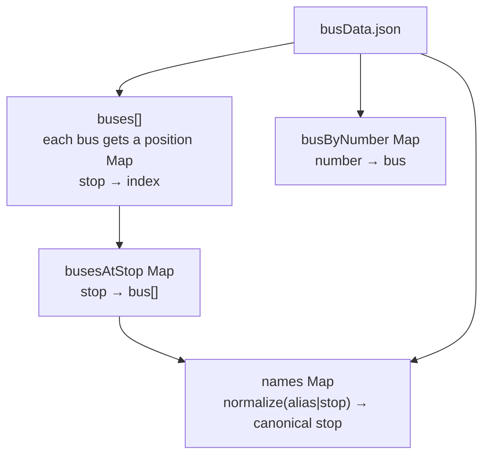
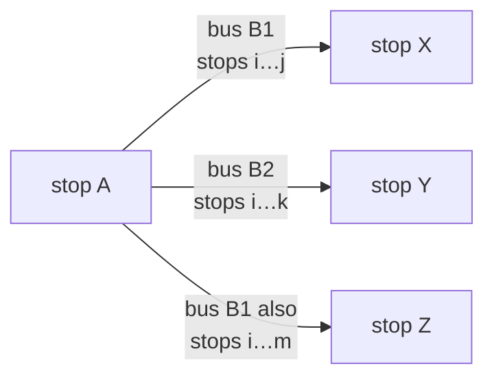
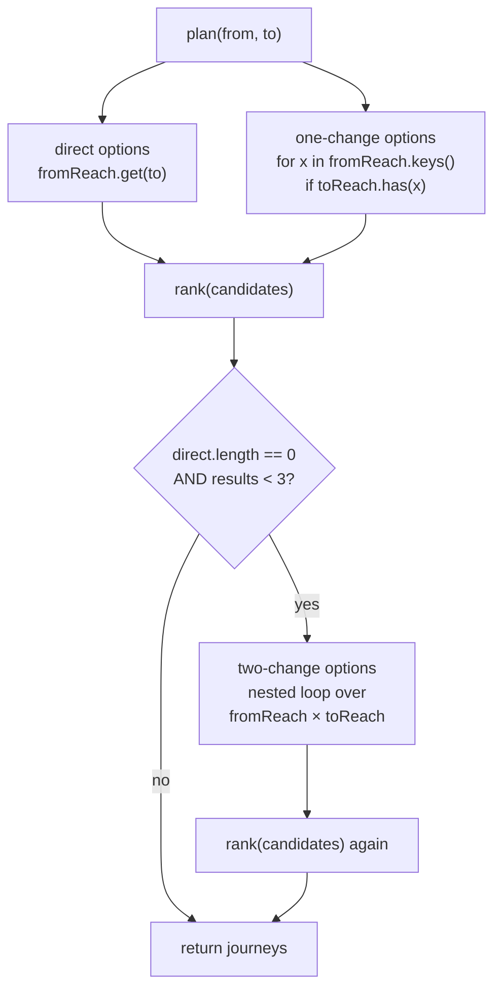

# Planner — how route-finding works

`backend/planner.js` does everything "smart": fuzzy stop search, typo correction,
journey planning, and result ranking. It has **zero dependencies** and is a pure module —
it reads nothing from disk and writes nothing. All state lives in the closures returned
by `createPlanner(data)`.

---

## 1. Data structures built at startup



`busesAtStop` is the core index. Everything else is derived from it.

`names` lets a user type `lalbagh`, `Lal Bagh`, `STATEBANK`, `airport`, or `IXE`
and get the right canonical stop name back.

---

## 2. Stop search & typo tolerance

`search(query, limit)` scores every alias/stop name against the typed query:

| Priority | Condition                                | Score              |
| -------- | ---------------------------------------- | ------------------ |
| 1        | Exact normalized match                   | 1.0                |
| 2        | Alias/stop **starts with** query         | 0.9                |
| 3        | A **word** in the name starts with query | 0.8                |
| 4        | Query is a **substring**                 | 0.7                |
| 5        | Levenshtein similarity ≥ 0.60            | similarity × 0.69  |
| —        | Empty query                              | 0.1 (show busiest) |

Scores are per alias; the best alias score wins for each canonical stop.
Ties are broken by the number of buses at that stop (busier stops rank higher).

`resolve(input)` calls `search` and auto-corrects when there is **one clear winner**
(score ≥ 0.55 and ≥ 0.10 ahead of the second hit). Otherwise it returns suggestions.

---

## 3. `reach(stop)` — the core primitive

> "Every stop one bus can take you to from here."



For each bus at `A`, and for each other stop `S` on that bus, `reach(A)` records:

```
stop S → [ option₁, option₂, … ]
```

An **option** is one specific sequence of stops from A to S:

```js
{
  buses: ["17", "17A", "17B"],   // buses that share this exact sequence
  stops: ["State Bank", "Car Street", …, "Surathkal"],
  rides: 16                       // stops.length - 1
}
```

Buses that run the **exact same road** (same stop sequence) are grouped into one option.
Options are sorted shortest-first, then by most buses.

`reach` results are **cached** (`reachCache`) because the same stop appears as an
intermediate in thousands of two-change queries.

---

## 4. Journey planning



### Scoring

```
cost = stops_ridden + CHANGE_PENALTY × number_of_changes
```

`CHANGE_PENALTY = 6` — changing bus is treated as riding 6 extra stops
(waiting time + walking).

### Deduplication — `hasPointlessChange`

A candidate is discarded when **any bus appears in two legs**: that means you could
have stayed on that bus and skipped the intermediate stop. This keeps the results
genuinely distinct.

### De-duplication of results

After scoring, journeys are keyed by the **first bus of each leg** joined with `>`.
Only the cheapest journey per key is kept. Up to 5 journeys are returned.

---

## 5. Confidence

Each bus carries a `confidence` field: `"high"`, `"medium"`, or `"low"` (see
[`DATA_NOTES.md`](../DATA_NOTES.md) for how they were assigned).

A leg that groups several buses (`["17","17A","17B"]`) shows the confidence of the
**least-trusted bus** in that group — it is only as good as its weakest member.

```
rank = { high: 3, medium: 2, low: 1 }
leg.confidence = min(rank[bus.confidence] for bus in leg.buses)
```

---

## 6. Exported API

```js
const { createPlanner, normalize, CHANGE_PENALTY } = require("./planner");
const planner = createPlanner(data);

planner.search(query); // → [{ stop, score, buses }]
planner.resolve(input); // → { stop, corrected } or { stop:null, suggestions }
planner.plan(from, to); // → [journey, …]
planner.getBus(number); // → bus descriptor or null
planner.listBuses(); // → [bus descriptor, …]
planner.busiestStops(n); // → [stopName, …]
planner.stopCount; // number of distinct stops
planner.stops(); // → [stopName, …]
```
