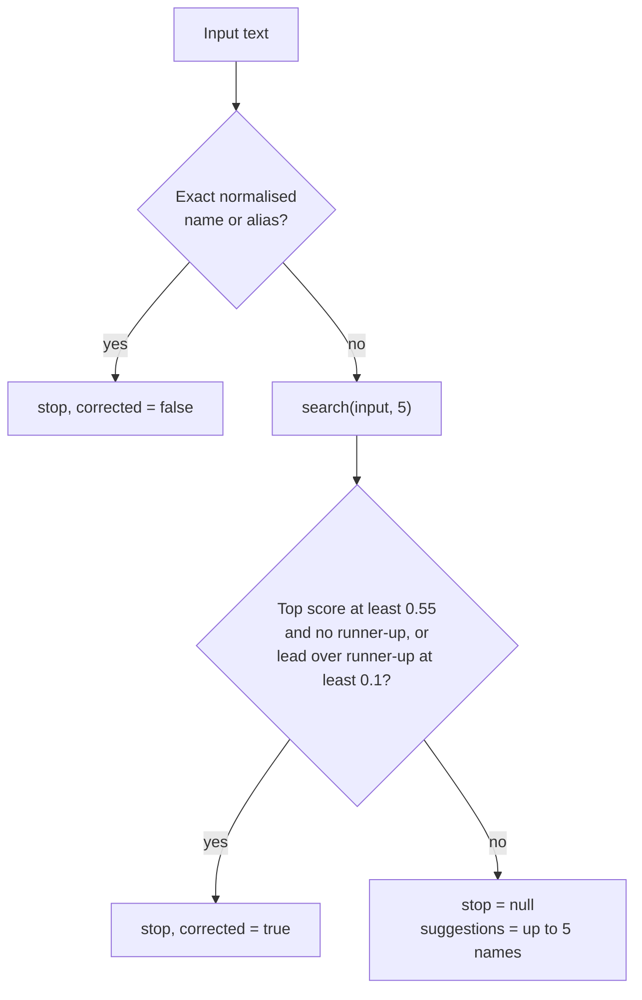
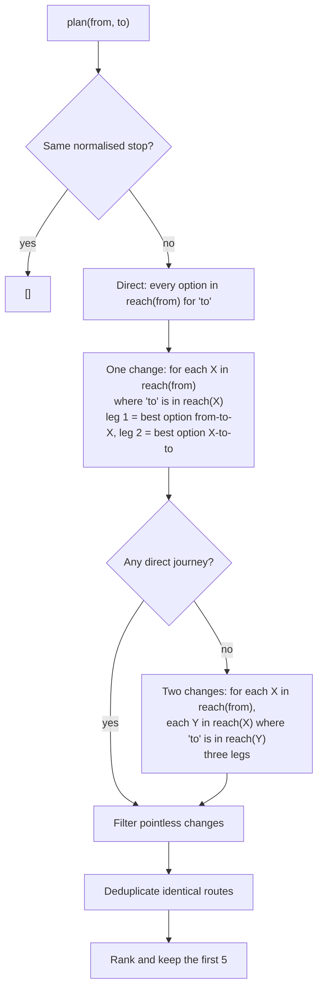
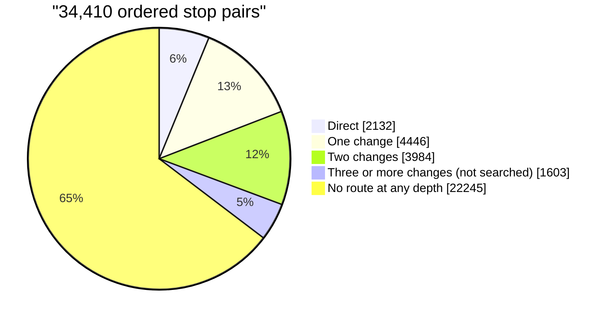

# Planner

`backend/planner.js` exports `createPlanner(data)`, `normalize()` and `EVIDENCE_STATUSES`. It does no file or network I/O. This document describes what the code does today; where a behaviour is a limitation it says so.

## Interface

| Method                     | Returns                                                                                           |
| -------------------------- | ------------------------------------------------------------------------------------------------- |
| `search(query, limit = 8)` | Ranked stops `{ stop, score, buses }`, where `buses` is the **number** of routes serving the stop |
| `resolve(input)`           | `{ stop, corrected }` on success, or `{ stop: null, suggestions: [names] }`                       |
| `plan(from, to)`           | Up to 5 journeys, ranked (empty array if none)                                                    |
| `getBus(number)`           | One bus (looked up case-insensitively) or `undefined`                                             |
| `listBuses()`              | All buses                                                                                         |
| `busiestStops(n = 3)`      | Names of the stops with the most routes                                                           |
| `stops()`, `stopCount`     | Canonical stop names and their count                                                              |

## Indexes built at startup

- `busByNumber`: bus number to bus.
- `busesAtStop`: stop to the buses that serve it, with each stop's position in each bus.
- `names`: normalised stop name to stop, then normalised alias to stop. An alias is added only if its target is a real stop and its key is not already a stop name.
- `reach(stop)`: built **lazily and cached for the life of the process**. For every bus at the stop it lists the stops _after_ it on that bus.

`normalize(s)` lower-cases, replaces every run of characters outside `a-z0-9` with one space and trims. Non-ASCII letters are discarded.

## Search and stop resolution

`search()` scores each stop by its best-matching name or alias:

| Match                                                                                       | Score             |
| ------------------------------------------------------------------------------------------- | ----------------- |
| Empty query (every stop)                                                                    | 0.1               |
| Exact normalised name or alias                                                              | 1.0               |
| Name starts with the query                                                                  | 0.9               |
| A word in the name starts with the query                                                    | 0.8               |
| Query appears inside the name                                                               | 0.7               |
| Fuzzy: best Levenshtein similarity to the whole name or to any single word, if at least 0.6 | similarity × 0.69 |

Ties are broken by number of buses (more first), then by name. With an empty query, the order is therefore "busiest stops first".

`resolve()` decides whether the input can be used as a stop:



Because a fuzzy score is `similarity × 0.69`, a typo-only match reaches 0.55 only at similarity of about 0.80 or better. Anything weaker, or any tie between candidates, returns suggestions and never guesses. `kankandy` resolves to _Kankanady_; `Kot` is ambiguous and returns _Kottara Chowki, Kottara Cross, Kotekar, Kotepura, Kottara_.

An input with no ASCII letters or digits (for example Kannada script) normalises to an empty string, so it is treated as an empty query: no match, with the busiest stops as suggestions.

## Journey search



How a **leg** is built. `reach(from)` groups buses whose stored stop sequence between the two stops is _identical_ (for example `17`, `17A` and `17B`). Each group is one option with `buses`, `stops` and `rides = stops - 1`. Options are ordered by fewest rides, then by more buses.

Rules that shape the output:

- **Forward only.** A bus is considered only from a stop to stops that come later in its sequence.
- **Direct options are all listed.** Every distinct road between the two stops appears.
- **Transfer legs use only the best option.** For one- and two-change journeys, each leg takes the fewest-ride option and ignores any alternative road between the same two stops. This is a known simplification: alternatives for individual legs are not enumerated.
- **Two changes only when there is no direct journey.** The two-change search is skipped if any direct journey exists. Its candidates compete in the same ranking as one-change candidates, so they appear only if fewer than five better ones exist.
- **Never more than two changes.** Three or more are not searched. See coverage below.
- **Pointless changes are removed.** A journey is dropped if, for two adjacent legs, any bus used on the first leg also serves the first leg's start and the second leg's end in forward order, because the passenger could simply stay on that bus. This check was once wrong: it wrongly removed 27 valid pairs (for example _Urva Stores_ to _Chilimbi_) and is now covered by regression tests.

### Ranking

Candidates are sorted by:

1. fewest changes,
2. fewest total rides (stops travelled),
3. first bus number of the first leg, compared as a **plain string** (`localeCompare` without numeric collation, so `10` sorts before `2`).

Journeys with identical stop paths are collapsed, keeping the lower internal cost (`rides + 6 × changes`). That cost is never used to rank and never leaves the planner. The response carries this note on every journey:

> Ranked by fewer transfers first, then fewer stops. This is a heuristic — not travel time.

Time, distance, frequency, walking and fares play no part.

### Evidence on a leg

A leg with several grouped buses reports the **weakest** evidence among them, per dimension. Statuses are ordered from strongest to weakest:

`VERIFIED` → `PARTIALLY_VERIFIED` → `UNVERIFIED` → `CONFLICTING` → `HISTORICAL` → `UNKNOWN`

So if one grouped bus has `UNKNOWN` current operation, the whole leg reports `UNKNOWN`. A leg also carries the lowest `confidence` of its buses, but the API removes that field.

### Journey shape

```json
{
  "changes": 1,
  "rides": 6,
  "legs": [
    {
      "buses": ["1", "1B", "13", "13A"],
      "from": "Car Street",
      "to": "Urva Stores",
      "rides": 4,
      "stops": ["Car Street", "…", "Urva Stores"],
      "evidence": { "…": "…" }
    }
  ],
  "rankingNote": "Ranked by fewer transfers first, then fewer stops. This is a heuristic — not travel time."
}
```

Real responses are in [API](api.md).

## Coverage (measured)

Measured on 2026-11-13 by running `plan()` for **every ordered pair of the 186 stops (34,410 pairs)** against the committed `busData.json`, and independently computing the minimum number of bus rides between every pair by breadth-first search over the raw route sequences.



| Result                                            |      Pairs |     Share |
| ------------------------------------------------- | ---------: | --------: |
| Direct                                            |      2,132 |      6.2% |
| Needs one change                                  |      4,446 |     12.9% |
| Needs two changes                                 |      3,984 |     11.6% |
| **Returned by the planner (at most two changes)** | **10,562** | **30.7%** |
| Needs three changes (exactly)                     |      1,230 |      3.6% |
| Needs four or more changes                        |        373 |      1.1% |
| No route at any depth                             |     22,245 |     64.6% |

What the numbers say:

- **The planner finds every pair that is reachable within two changes.** The BFS finds no pair reachable within three rides that the planner misses (also asserted by `test/completeness.test.js`). So the gap is the data and the two-change limit, not the search code.
- **1,603 pairs (13% of all reachable pairs) need three or more changes** and return no result. Adding a third change was deferred because many of these pairs may collapse once return directions exist, and because it would raise worst-case query cost.
- **The data is shaped like a star.** 84 of 99 routes start at _State Bank_. From _State Bank_ the planner reaches 180 of the other 185 stops, but **no stop can reach _State Bank_** (it is only ever a route origin), so every "to State Bank" query is empty. Only 660 unordered stop pairs are reachable in both directions; 9,242 are reachable in one direction only.
- **36 stops can never be a starting point** (they are the last stop of every route they appear on, for example _Kunjathbail_, _Shaktinagar_, _J.M. Road_), and **4 stops can never be a destination** (_State Bank_, _Bengare_, _Anandanagar_, _Padil Railway Station_).

An empty result therefore means "no connection **recorded** within two changes in the stored direction". The API's `reverseRecorded` flag only says whether the opposite direction returns anything; it does not prove a bus does or does not run.

### Reproduce

```bash
node -e '
const { createPlanner } = require("./backend/planner");
const p = createPlanner(require("./data/busData.json"));
const stops = p.stops(); let total = 0, found = 0;
for (const a of stops) for (const b of stops) if (a !== b) { total++; if (p.plan(a, b).length) found++; }
console.log(found, "of", total, "pairs have a journey");
'
```

Expected output with the committed data: `10562 of 34410 pairs have a journey`. The test `test/exhaustive.test.js` prints the same figure as unreachable (23,848).

## Performance

Planner-only timings (no HTTP) on a Linux container, Node 22.23. They vary by machine; treat them as order-of-magnitude.

| Operation                              | Measured                                      |
| -------------------------------------- | --------------------------------------------- |
| `createPlanner(data)`                  | about 0.3 ms                                  |
| First-ever query (builds reach caches) | 0.01 to 38 ms across a sample                 |
| Warm `plan()`                          | roughly 0.002 to 0.4 ms depending on the pair |
| Warm `search("kank")`                  | about 0.6 ms                                  |
| All 34,410 pairs                       | about 1.4 s                                   |

See [Testing](testing.md#performance) for the cases and caveats. No HTTP load test has been run.
