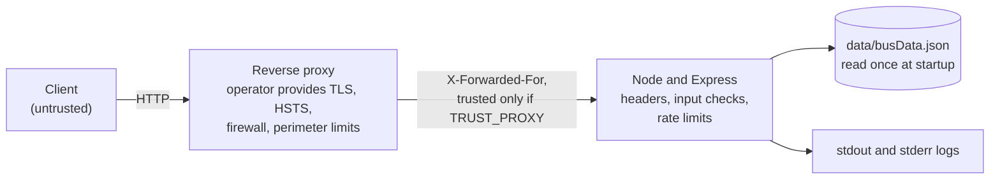

# Security

What the application does to protect itself, what the operator must provide, and where the gaps are. This is a source review plus running the server locally (headers, rate limiting and error behaviour were observed on a live process). It is **not** a penetration test, and no external security testing has been done.

## Threat context

Kudla Route is a public, read-only service.

- No user accounts, sessions, passwords or cookies.
- No file uploads, no request bodies (no `POST` routes exist, and no body parser is installed).
- No personal data is sent to the server. Recent searches stay in the browser's `localStorage`.
- No secrets, no database, no outbound network calls.
- One production dependency (Express 5).

So the realistic risks are availability (abuse, resource use), integrity of the dataset on disk, injection through input that is echoed back, information leakage through errors and logs, and supply-chain risk in a single dependency. Confidentiality of user data is largely moot because the server holds none.

## Controls that exist

### HTTP headers

Set on **every** response, static and API (observed on a live server):

| Header                    | Value                                                                                                              |
| ------------------------- | ------------------------------------------------------------------------------------------------------------------ |
| `X-Content-Type-Options`  | `nosniff`                                                                                                          |
| `X-Frame-Options`         | `DENY`                                                                                                             |
| `Referrer-Policy`         | `no-referrer`                                                                                                      |
| `Permissions-Policy`      | `geolocation=(), microphone=()`                                                                                    |
| `Content-Security-Policy` | `default-src 'self'; style-src 'self'; font-src 'self'; script-src 'self'; img-src 'self'; frame-ancestors 'none'` |
| `X-Powered-By`            | removed                                                                                                            |

The CSP has **no** `'unsafe-inline'`, so inline scripts and style attributes are blocked; the frontend is written to comply (external scripts, `style.setProperty`). It does not set `base-uri` or `form-action`, which do not fall back to `default-src`; nothing in the page currently needs them.

There is **no `Strict-Transport-Security` header** and no HTTP-to-HTTPS redirect. The app cannot know whether it is behind TLS, so this belongs to the proxy.

### Input handling

| Input                                | Handling                                                                                                                          |
| ------------------------------------ | --------------------------------------------------------------------------------------------------------------------------------- |
| `from`, `to`, `q`, `/api/stop/:name` | Coerced to string, trimmed, cut to 60 characters, then matched against the stop list. Never used in a file path, query or command |
| Query parameters                     | Repeated parameters return `400`; non-string values return `400`                                                                  |
| `/api/bus/:number`                   | Looked up in a map. **Not** trimmed or length-capped. A 404 echoes the raw value inside a JSON string                             |
| URL encoding                         | A malformed percent-encoding (`/api/stop/%E0%A4%A`) returns `500`, not `400` (observed)                                           |

The 404 echo is JSON, so it is not an injection risk on its own. The length is bounded by Node's HTTP header size limit, not by the app. The risk is only in a consumer that renders the message as HTML; the bundled frontend does not.

### Output handling

- API responses are JSON built from the validated dataset.
- The frontend builds the page with DOM nodes and text; a search of `frontend/` finds no `innerHTML`, `outerHTML`, `insertAdjacentHTML`, `document.write` or `eval`. Combined with the CSP, script injection through stop names or error messages has no obvious path.
- Responses contain the dataset's stop and bus names only (plus the echoed bus number above).

### Rate limiting

In-memory, fixed window, keyed by client IP (`req.ip`, falling back to the socket address).

| Scope        | Limit                         | Window | Endpoints                                                          |
| ------------ | ----------------------------- | ------ | ------------------------------------------------------------------ |
| Plan         | 30                            | 60 s   | `/api/plan`                                                        |
| Autocomplete | 120                           | 60 s   | `/api/stops`                                                       |
| Other API    | 60, one shared counter per IP | 60 s   | `/api/health`, `/api/buses`, `/api/bus/:number`, `/api/stop/:name` |

Behaviour (tested): the counter increments on every request including rejected ones; the first request past the limit gets `429` with `Retry-After` (seconds) and `{ "error": "Too many requests. Please slow down.", "retryAfterMs": … }`; other IPs and other limiter scopes are unaffected; expired records are removed on a 5-minute timer that does not keep the process alive.

Limits that matter:

- **Static files are not limited.**
- **Per process only.** Counters reset on restart and are not shared between instances. There is no Redis or other store.
- **Needs the right `TRUST_PROXY`.** Behind a proxy with the default `false`, every client has the proxy's address and shares one bucket: one user can exhaust `/api/plan` for everyone (30 per minute in total). With a trusting setting on a Node port that clients can reach directly, a client can forge `X-Forwarded-For` and evade the limits. See [Operations](operations.md#choosing-trust_proxy).
- **No global cap and no entry cap** on the counter map. Many distinct addresses grow it until cleanup.

### Errors and logging

- Unexpected errors return `{ "error": "Something went wrong on the server." }`. No stack trace or internal detail goes to the client.
- The error object **is** written to stderr, which can contain a stack trace and fragments of the request path. Treat stderr as sensitive.
- Request logs use route templates (`GET /api/stop/:name`) and omit query strings, stop names, bus numbers and static file names. Unknown API paths log as `GET /api/*`; if you add an endpoint, add a template to `ROUTE_TEMPLATES` in `backend/index.js` or it will be logged under that generic label (nothing leaks either way).

### Dataset integrity

- The dataset is validated at startup; invalid data stops the process (exit 1) instead of serving wrong or crashing results later.
- Validation also guards structure that would break planning, for example two spellings of one stop or an alias pointing nowhere.
- Nothing at runtime writes to `data/`. Make it read-only for the service user; a writable dataset is the main integrity risk, and the application cannot defend it.

### Dependencies

- One production dependency: `express`. `npm audit --audit-level=high` reported **0 vulnerabilities** when run on 2026-11-13 against a freshly resolved tree (Express 5.3.0). That is not the repository's own lockfile, and an audit is a point-in-time result.
- A CI workflow that runs the audit is described in the earlier README, but it was not in the reviewed export and no run has been recorded.
- The earlier project log reports a secret scan with no findings beyond the word "private" in unrelated text; no secrets are needed to run the app.

## What the operator must provide

The application does not and cannot supply:

| Need                                                         | Why                                                                                                      |
| ------------------------------------------------------------ | -------------------------------------------------------------------------------------------------------- |
| **TLS and HTTPS redirects**                                  | The app serves plain HTTP                                                                                |
| **HSTS**                                                     | The app does not send it                                                                                 |
| **A firewall or bind address**                               | It listens on all interfaces; block direct access to the Node port, especially when `TRUST_PROXY` is set |
| **Perimeter and distributed rate limiting, DDoS protection** | Built-in limits are per process and per address                                                          |
| **Correct `TRUST_PROXY`**                                    | See above                                                                                                |
| **Read-only `data/` for the service user**                   | Prevents tampering with the dataset                                                                      |
| **Log protection and retention**                             | stderr can hold stack traces                                                                             |
| **Dependency audits on your own lockfile**                   | The result above is not yours                                                                            |

## Threats and responses

| Threat                                          | Response in code                                                                                  | Gap                                                                                                      |
| ----------------------------------------------- | ------------------------------------------------------------------------------------------------- | -------------------------------------------------------------------------------------------------------- |
| Oversized or malformed input exhausts resources | 60-character cap, query-shape checks, bounded result sets, sub-millisecond to tens-of-ms planning | `:number` is uncapped; the malformed-URL case returns 500                                                |
| Request flooding                                | Per-route, per-IP limits                                                                          | In-memory, per process, bypassable by spoofed headers or many addresses; static not limited              |
| Spoofed client IP                               | `TRUST_PROXY` off by default; accepts only `1` or `loopback`                                      | Operator must choose correctly                                                                           |
| XSS                                             | Strict CSP, text-only DOM, JSON responses                                                         | Not verified in a real browser; no automated check                                                       |
| Clickjacking, MIME sniffing                     | `X-Frame-Options`, `frame-ancestors`, `nosniff`                                                   | None known                                                                                               |
| Information disclosure in errors or logs        | Generic 500, route-template logs                                                                  | stderr holds the raw error object                                                                        |
| Dataset tampering                               | Startup validation                                                                                | Needs filesystem permissions the app cannot set                                                          |
| Dependency compromise                           | Single dependency, lockfile, audit                                                                | Not verified in CI; audit shown above is point-in-time                                                   |
| Caching of sensitive data                       | Matched handlers send `no-cache`                                                                  | Early errors (query-shape 400, unmatched 404, 429) send no `Cache-Control`; nothing sensitive is in them |

## Issues found and fixed during the earlier audit

For traceability. All were fixed in code and are covered by tests.

1. `X-Powered-By` disclosed the framework.
2. No security headers or CSP.
3. Unbounded query inputs.
4. Stack traces could reach clients.
5. No startup validation of the dataset.
6. Static assets had no cache policy.
7. No health endpoint.
8. Bus routes were traversed in both directions, producing impossible return journeys.

## Not verified

- Headers and CSP in a real browser (they were observed with `curl` and in-process tests only).
- Any external security review or penetration test.
- Behaviour behind a real proxy, with real TLS, or under load.
- A CI run, including the audit step.
