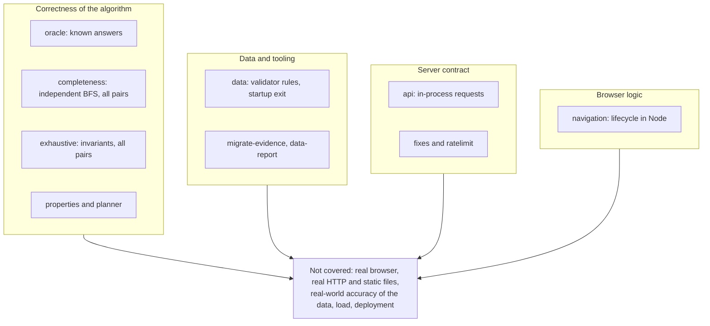

# Testing

What the 117 tests cover, what they cannot tell you, and what was reproduced. The runner is Node's built-in `node:test`; there are no test dependencies.

## Verification record

Reproduced on **2026-11-13** from a clean checkout of the exported files (Node 22.23.4, Linux container, Express 5.3.0 installed fresh with `npm install`):

| Check                                         | Result                                                                                                                     |
| --------------------------------------------- | -------------------------------------------------------------------------------------------------------------------------- |
| `npm test`                                    | **117 tests, 7 suites, 117 passed, 0 failed, 0 skipped, 0 cancelled**, about 9.4 s                                         |
| `npm run data:validate-baseline`              | Valid. Regenerated `KUDLA_DATASET_VALIDATION.json` is **byte-identical** to the committed one                              |
| `npm run data:report`                         | Runs; under 1 second                                                                                                       |
| `npm audit --audit-level=high`                | 0 vulnerabilities (freshly resolved tree, not the repo's lockfile)                                                         |
| `node scripts/smoke.js` against a live server | **11 of 12 checks pass; 1 fails (a bug in the script)**, exit code 1. See [Status](status-and-limitations.md#known-issues) |

Not reproduced: any browser run, a CI run, a load test, a deployment. None of these exist.

## Running

```bash
npm test                              # all 12 files, about 10 s
node --test test/planner.test.js      # one file
```

`npm test` runs `node --test` with an **explicit list** of the 12 files in `package.json`. A new `test/*.test.js` file is **not** picked up until you add it to that list.

## What is tested

| File                       | Tests |  Time | Covers                                                                                                                                                                                                                             |
| -------------------------- | ----: | ----: | ---------------------------------------------------------------------------------------------------------------------------------------------------------------------------------------------------------------------------------- |
| `planner.test.js`          |    16 | 0.3 s | Direct, grouped and ranked journeys; forward-only; typing, alias and typo forgiveness; suggestions; autocomplete order; evidence shape; ranking note                                                                               |
| `oracle.test.js`           |    12 | 0.1 s | A hand-built five-bus network where every correct answer is known in advance (direct, one change, unreachable reverse, isolated networks, ranking, required fields)                                                                |
| `properties.test.js`       |    13 | 0.3 s | Deterministic invariants over the real data: `normalize` is idempotent and lower-case; stop lists are non-empty and unique; results are sorted, non-empty and free of duplicate journeys; `plan(A, A)` is empty                    |
| `completeness.test.js`     |     6 | 3.6 s | An independent breadth-first oracle over the raw routes: for **all 34,410 pairs**, if a pair is reachable within two changes the planner returns it (0 missed); 27 named regression pairs; no internal cost leaks                  |
| `exhaustive.test.js`       |     3 | 3.7 s | Structural invariants on every journey for all 34,410 pairs: at most two changes; legs join end to start; each leg's stops are a real forward slice of its bus; rides add up; no avoidable transfer; sorted; evidence on every leg |
| `data.test.js`             |    19 | 0.3 s | The real dataset passes validation; each rule of `validateDataset` rejects bad input; evidence and confidence agree; startup **spawns a process** and checks it exits with useful errors                                           |
| `api.test.js`              |    10 | 0.5 s | All six endpoints, error contracts, query-shape errors, headers, cache headers, rate limiting, `TRUST_PROXY` keying, JSON 404                                                                                                      |
| `fixes.test.js`            |    21 | 0.2 s | Log-label redaction (`safeRouteLabel`), stop resolution, `busiestStops`, `reverseRecorded` semantics                                                                                                                               |
| `ratelimit.test.js`        |     4 | 0.1 s | Limit, `Retry-After` and window reset, separation by IP and limiter, cleanup, using an injected fake clock                                                                                                                         |
| `migrate-evidence.test.js` |     7 | 0.1 s | Dry-run default, idempotence, never downgrading evidence, backup and atomic write, rejecting bad input                                                                                                                             |
| `navigation.test.js`       |     4 | 0.1 s | The request-lifecycle and history-navigation logic of `navigation.js`, plus one source-text check of `index.html` and `app.js`                                                                                                     |
| `data-report.test.js`      |     2 | 0.1 s | `direction-aware-report.js`: hashing, counts, and rejecting a mutated baseline                                                                                                                                                     |



## What the tests prove, and what they do not

**They prove** that the planner is internally consistent and complete for the committed data. The completeness oracle is independent of the planner code, so "the planner finds every reachable pair within two changes" is a real result, not a restatement. Validation rules, the API contract and the limiter behave as described.

**They do not prove** that any journey matches a real bus. The data's accuracy is a separate, unresolved question (see [Data](data.md#provenance-and-history)). A test suite that passes 117 times says nothing about whether route 45A really runs where the dataset says.

### What is not tested

- **No real browser.** There is no DOM, rendering, accessibility or CSP test. Autocomplete, recent searches, the share button, the route filter and the stop panel have no automated tests at all.
- **No real HTTP or static serving.** `api.test.js` calls `app.handle()` with synthetic request and response objects. That covers every handler and the headers they set, but static file serving, real sockets, and connection handling are not exercised. (They were checked once by hand for this documentation.)
- **No load test.** Planner timings exist ([below](#performance)); HTTP throughput does not.
- **No coverage tool** has been run, so coverage is unmeasured.
- **`data/scripts/report.js` has no test**, and it runs on import (no `require.main` guard), so it cannot be required safely from one.
- **No test of the CSS or fonts.**

### Tests whose names promise more than they check

Read these before citing the suite as evidence:

| Test                                                                                                      | What it actually does                                                                                                                                                                                    |
| --------------------------------------------------------------------------------------------------------- | -------------------------------------------------------------------------------------------------------------------------------------------------------------------------------------------------------- |
| `planner.test.js`: "every stop can reach every busiest stop"                                              | Asserts only that **if** a journey exists it starts and ends correctly; its own comment says reachability is not asserted. In reality **no stop can reach _State Bank_**, one of the three busiest stops |
| `planner.test.js`: "direction is stored only as forward: reverse requires a transfer or separate pattern" | The comment says a journey is found via transfers for _Kunjathbail_ to _State Bank_; none is (other tests pin an empty result). It passes without checking that                                          |
| `completeness.test.js`: "3+ changes decision record"                                                      | Logs the count of pairs needing exactly three changes (1,230) and asserts only that it is a finite number `>= 0`. It cannot fail                                                                         |
| `navigation.test.js`: last test                                                                           | Reads `index.html` and `app.js` as text and matches strings (script order, presence of certain calls). It checks that code is present, not that it behaves                                               |
| Several in `fixes.test.js`                                                                                | Assert only `Array.isArray(...)` on a result                                                                                                                                                             |
| `api.test.js`: malformed percent-encoding                                                                 | Pins a `500` for a client error. Correct as a description of today's behaviour, arguably the wrong behaviour                                                                                             |

### What "property" and "exhaustive" mean here

`properties.test.js` is a set of deterministic invariant checks, not randomised property-based testing (there is no random input or shrinking). `exhaustive.test.js` and `completeness.test.js` loop over **every** ordered pair of the 186 stops, which is thorough for this dataset but is invariants over data, not evidence about the real world. Both print a diagnostic: `Pairs checked: 34410 | Unreachable: 23848 (69.3%)`.

## Feature to evidence

| Feature                                                                        | Automated evidence                          |
| ------------------------------------------------------------------------------ | ------------------------------------------- |
| Direct, one-change and two-change journeys                                     | planner, oracle, completeness, exhaustive   |
| Ranking and the 5-journey cap                                                  | planner, properties, exhaustive             |
| Forward-only traversal                                                         | planner, oracle, fixes, exhaustive          |
| Pointless-change removal                                                       | planner, completeness (27 regression pairs) |
| Typo, alias and spacing tolerance; suggestions                                 | planner, fixes, api                         |
| Bus list, bus detail, stop detail, health                                      | api                                         |
| Per-dimension evidence                                                         | data, planner, exhaustive                   |
| Rate limiting                                                                  | ratelimit, api                              |
| Security headers, cache headers                                                | api (in-process only)                       |
| Startup validation and exit code                                               | data (spawns a process)                     |
| Log redaction                                                                  | fixes                                       |
| Shareable URL, history, stale-response guard                                   | navigation (logic only), source-text check  |
| Recent searches, keyboard autocomplete, share button, route filter, stop panel | **none** (source review only)               |

## Performance

Planner-only timings, no HTTP. Measured on 2026-11-13 in a Linux container on Node 22.23.4. Absolute numbers depend on the machine; they show order of magnitude.

| Case                           | Result                  | Cold first query |               Warm, average |
| ------------------------------ | ----------------------- | ---------------: | --------------------------: |
| _State Bank_ to _Lalbagh_      | direct, 5 journeys      |            22 ms |   about 0.4 ms (1,000 runs) |
| _Car Street_ to _Lalbagh_      | two changes, 2 journeys |           7.5 ms |    about 0.08 ms (200 runs) |
| _Kadri_ to _Falnir_            | no journey              |           5.5 ms |    about 0.11 ms (100 runs) |
| _Bajpe Airport_ to _Surathkal_ | no journey              |          0.01 ms | about 0.002 ms (1,000 runs) |

Also: `createPlanner(data)` about 0.3 ms; `search("kank")` about 0.6 ms warm; the slowest cold plan in a 300-pair sample was 38 ms (_State Bank_ to _Urva Stores_, which builds many reachability caches); all 34,410 ordered pairs together took about 1.4 s. Server start (require, validate, build) about 60 ms; resident memory about 60 MB.

These are single-thread CPU timings. A previous log recorded similar sub-millisecond figures on another machine, but mislabelled _State Bank_ to _Lalbagh_ as a one-change case (it is direct) and _Kadri_ to _Falnir_ as reachable (it is not). No HTTP latency or concurrency figure exists.

## Adding or changing tests

1. Put the file in `test/` as `<name>.test.js` using `node:test` and `node:assert`.
2. **Add it to the `test` script in `package.json`.** Otherwise it never runs.
3. For API tests, reuse the in-process pattern in `api.test.js`: export the app (`require("../backend/index.js")`), build a request with `Object.create(express.request)`, call `app.handle(req, res)`. Keep the 429 tests independent by using distinct `req.ip` values and fresh limiters.
4. For data rules, add the failing case to `data.test.js` first; `validateDataset` returns all errors, so assert on the message you expect.
5. If you change `busData.json`, expect `exhaustive.test.js` and `completeness.test.js` to cover the new data automatically, and update any figures quoted in these docs ([Planner coverage](planner.md#coverage-measured) and [Data](data.md#dataset-facts)).
6. Do not put test counts in prose documentation. Counts go stale (an earlier doc listed `data.test.js` at 6 tests; it has 19).

## Smoke test

`node scripts/smoke.js [base-url]` (default `http://localhost:3000`) makes 12 requests: health, autocomplete, a direct plan, a no-result plan with `reverseRecorded`, a typo-corrected plan, the bus list, one bus, a missing bus, one stop, two bad plan requests, and the home page. It exits non-zero on any failure.

**Known bug:** the home-page check is passed through the same helper as the JSON checks, which calls `res.json()` on HTML. The check therefore always fails and the script always exits 1. Treat the other 11 results as valid and fix the script before using it as a deploy gate.
